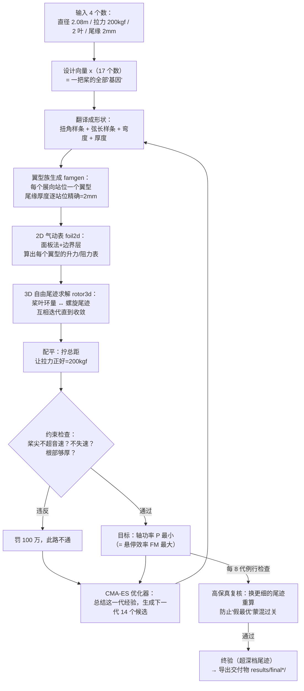
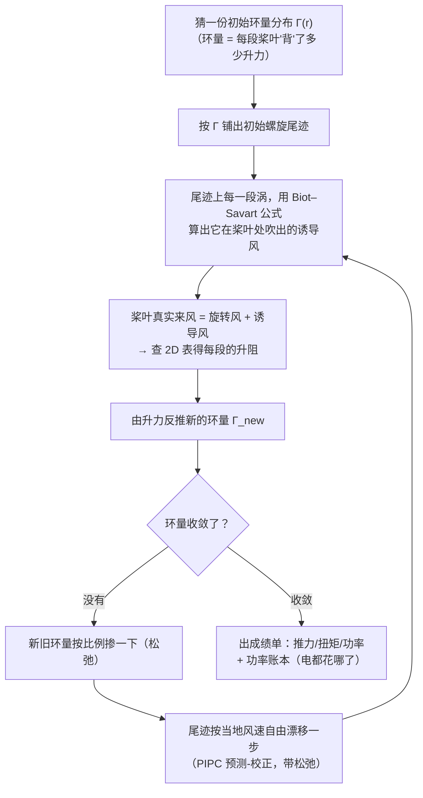

# rotorgen 全流程图解（人话版）

> 这份文档解释这套程序**从头到尾是怎么工作的**：每个模块干什么、算法怎么走、为什么这么设计。
> 全文用人话写，所有行话第一次出现都会当场解释。配套文档：
> [验证报告（人话版）](VERIFICATION_REPORT.md) · [FM 0.75 提升计划](FM075_PLAN.md) · [研究日志](../RESEARCH_AND_BENCHMARK_LOG.md)

---

## 0. 这个项目到底是干嘛的（30 秒版本）

想象有人给你提了一个要求：

> "帮我设计一台直径 2.08 米的'电风扇'，要能往上吹出 200 公斤的力，只用 2 片叶子，
> 叶子后缘厚度必须是 2 毫米，而且悬停时要**尽量省电**。"

这个程序接下这个单子后，**全自动**地做完了下面的事：

1. 自己画出叶片每个截面的翼型形状（机翼剖面）；
2. 自己决定叶片的平面形状（哪里宽哪里窄）和扭转角（叶根到叶尖各拧多少度）；
3. 用自研的空气动力学求解器算出"这么设计要耗多少电"；
4. 反复微调形状，一代一代试，直到电耗降不下去为止；
5. 输出一整套图纸和性能报告。

**输入是 4 个数字，输出是一套可制造的图纸。** 中间不需要任何商业软件（无 CAE / CFD 许可证），
只需要 `numpy / scipy / numba / matplotlib` 和一台普通电脑。完整寻优一晚上跑完。

---

## 1. 全流程总图



文字版（一行流程）：

```
输入(D,T,B,尾缘厚度) → 设计向量(17个数) → 翼型族(CST,2mm尾缘硬约束)
 → 2D升阻表(面板法+边界层,~3ms/迎角) → 3D自由尾迹求解(~13-57s/工况)
 → 配平到目标拉力 → CMA-ES寻优(快档内环+每8代高保真抽查)
 → 超深档终验 → 几何+性能交付
```

3D 求解器内部是一个"鸡生蛋"循环，单独画一张：



---

## 2. 名词小词典 —— 先把行话翻译成人话

### 2.1 旋翼的基本零件

| 名词 | 人话解释 |
|---|---|
| 桨盘 / 直径 D | 叶尖扫出来的圆。本项目 D=2.08 m |
| 桨叶数 B | 叶子片数，本项目 B=2 |
| 弦长 c | 翼型截面"迎风方向的宽度"，像叶片某处的宽度 |
| t/c（相对厚度） | 翼型最厚处除以弦长。12% 表示厚薄比 |
| 弯度 | 翼型中弧线弓起的高度，弓得越狠升力越大、阻力也大 |
| 扭转 / 扭角 | 叶片从根到尖逐渐"拧"的角度。因为叶尖转得快、需要的迎角小，不拧就会叶尖失速 |
| 总距（集体距） | 整片桨一起拧的基准角，直升机上下用的"油门"。**配平**就是拧它来凑够 200 kgf |
| 实度 σ | 所有叶片面积 / 桨盘面积，"叶子盖住圆面的比例"。2 叶细叶 ≈ 0.1~0.2 |
| 桨尖速度 Vt / 转速 | 叶尖的线速度（本设计约 156 m/s）和每分钟转数（约 1400 RPM） |
| 尾缘 | 翼型最后缘（"机翼尾巴"）。本项目要求是 2 mm 的**钝**尾巴（不是尖的），制造和强度需要 |

### 2.2 性能指标

| 名词 | 人话解释 |
|---|---|
| 推力 T | 往上吹的力，目标 200 kgf ≈ 1961 N |
| 功率 P | 电机要出的功率，**越小越好** |
| CT（推力系数） | 把推力除以"转速²×直径⁵×空气密度"这类组合，得到一个不随大小快慢变化的纯数字，方便拿不同尺寸的桨互相比 |
| CQ（扭矩系数） | 同理，扭矩的无量纲化 |
| 理想功率 P_ideal | 物理学给的下限：同样的盘、同样的拉力，一个"完美不浪费"的桨最少也要这么多电（动量理论算出 `T^1.5/√(2ρA)`）。真实桨只能更费电 |
| **FM（悬停品质因数）** | **FM = 理想功率 ÷ 实际功率**，即"你离完美有多近"，最大 1。电风扇类比：理论上吹 200 kgf 最少要 30.1 kW，你的风扇实际 40 kW，FM = 30.1/40 ≈ 0.75。这是本项目要最大化的唯一目标 |

### 2.3 这套代码自己造的词（重点，逐个交代来历）

**三档尾迹（fast / hi-fi / ultra）**
求解器算尾迹时，把一圈 360° 切成多少步（dψ）、往后追多少圈，决定了算得准不准和算得快不快。
就像看烟圈：拍照帧率越高、跟得越久越真实，但也越费时间。项目定了三个固定档位：

| 档位 | 每步转角 dψ | 追几圈 | 单次求解 | 用在哪 |
|---|---|---|---|---|
| fast（快档） | 10° | 4.5 圈 | ~13 秒 | 优化内环，跑几百万次的那种 |
| hi-fi（高保真档） | 7.5° | 6 圈 | ~25 秒 | 每隔几代抽查优化结果 |
| ultra（超深档） | 5° | 10 圈 | ~57 秒 | 最终交付前算总账 |

**φ（入流修正因子，代码里叫 inflow_scale）**
尾迹被切成一格格算，桨叶处的下洗风速会**系统性偏低**（格子太粗，漩涡细节丢了）。
实测对基准实验，把叶站位入流乘 1.2 后推力读数误差从 +22~48% 压到 +3.5~8.6%。
所以定 φ=1.2。它修的是"尾迹离散化"这一个特定误差源，不是万能贴。

**κ_cal（功率定标因子）**
另一个实测发现的系统性偏差：所有算例的**扭矩都被低估 15~25%**（尾迹离散 + 2D 阻力偏低的合力）。
于是把诱导功率整体乘 1.2，让扭矩读数贴近实验（最大残差 6%）。它和 φ 分工不同：
φ 管推力读数，κ_cal 管功率读数。注意这两个数都是**对着实验定出来的经验修正**，
项目把它们和"纯物理结果"分开记账，报告里永远双口径。

**κ_B（旧"毯子因子"，已删除）**
κ_cal 的前任。以前无条件把所有功率 ×1.2，后来发现它把"尾迹自己已经算出来的非理想性"
又重复罚了一遍（尾迹加深后 κ_raw 收敛到 1.18，再乘 1.2 等于罚了两次），已从代码里删除。
留着这个名字是因为研究日志里到处是它。

**Cd×1.15 硬修正**
自研 2D 求解器算出的阻力比风洞实验**系统性低 12~18%**（简化边界层的已知代价）。
为了防止优化器钻这个空子"追一个假的低阻力"，直接在表格生成时把 Cd 乘 1.15。

**瓦特账本**
把总功率拆成三项、每一项都有物理含义的记账法：
- **P_axial**：每段桨叶的推力 × 它头顶上的下洗风速 —— 把空气往下压着走花的功（大头，约 90%）；
- **P_swirl**：尾流打转的动能（很小，约 0.5%）；
- **P_prof**：空气摩擦叶片表面的阻力消耗（约 6%）。
没有藏任何"再乘个系数"的自由参数，每一瓦都能说出去向。

**同推力 CQ（CQ_matched）**
和实验比扭矩时，如果计算出的拉力和实验差一点，扭矩就没法直接比。
处理办法：把计算的 CQ 按"推力比^1.5"折算到和实验**相同拉力**后再比。
这是设计工况下唯一有意义的误差口径，因为设计管线永远工作在"拉力=200kgf"的配平状态。

**Gate A / B / C（闸门）**
项目给自己定的三道验收关卡：Gate A=模型准不准（核心工况误差 ±8~10%），
Gate B=一轮评估够不够快（<25 秒），Gate C=最终目标达没达标（FM≥0.75）。
每道闸门配了"止损条款"：达不到时走哪条备选路线，提前写好，不临时改规则。

**幻影最优**
优化器在快档（粗尾迹）里找到的"超级好设计"，拿到高保真档一复核就露馅——
通常是钻了粗模型的空子（比如刚好把失速藏在粗模型看不见的站位上）。
解法：每 8 代强制高保真抽查，抽查不过就否决。**2026-10-25 凌晨的 CMA-ES 运行中真实抓到过一只**
（详见验证报告 §11）。

**CQ 约定 bug（×R 惨案）**
无量纲化公式 CQ=Q/(ρΩ²πR⁵) 里，代码曾经写成 R⁴（少乘一个半径 R）。
物理量（多少牛、多少瓦）一直是对的，但所有"CQ 系数"读数都带着一个 ×R 的假因子，
导致 FM 系数公式只在 R=1 米时成立——DJI 小桨曾算出 FM=6.4（物理上不可能超过 1），
就是它暴露的。2026-10-24 修复，历史读数用公式 `(1+旧误差)/R−1` 去"消毒"。

### 2.4 求解器黑话

| 名词 | 人话解释 |
|---|---|
| BEMT | "叶素-动量理论"，教科书标配：把桨叶切成小段，每段用一维动量公式估算下洗。**快但粗糙**，算不准桨尖涡、尾迹收缩。本项目红线：**禁止把它当求解器** |
| 自由尾迹 | 不预设尾迹形状，让每一小段涡按当地风速自由漂移，最终自己收敛成真实的收缩螺旋。本项目 3D 求解的核心 |
| Biot–Savart 公式 | "一根通了'风'的导线，在旁边一点吹出多大风"的物理定律。涡段诱导速度的直接计算式 |
| 涡核 rc | 真实漩涡中心不是无穷大风速（龙卷风眼反而平静）。数值上给涡一个"软芯"半径，避免中心速度爆炸 |
| 桨尖涡 / 涡龄 | 叶尖甩出的那圈最强漩涡（直升机悬停时看到的下洗烟圈就是它）；涡龄=这个涡被甩出来后转了多少度 |
| PIPC | 伪隐式周期松弛：尾迹节点漂移的数值格式（预测-校正+超松弛），悬停自由尾迹的经典算法（Bagai–Leishman 1995） |
| 环量 Γ | 每段桨叶"背着"的升力强度的流体力学度量，升力 = ρ·V·Γ。它同时也是尾迹涡的强度来源 |
| 面板法 | 2D 无粘算法：把翼型表面切成小段，每段贴一条涡，解"空气不穿透表面"的方程组，得表面速度和升力 |
| 边界层 | 贴着壁面、空气被摩擦"粘住"减速的薄层。阻力（摩擦）和失速（分离）都由它决定 |
| Thwaites / Michel / Head | 边界层三段式算法的三块拼图：层流段推进 / 转捩判据（何时变湍流）/ 湍流段推进 |
| Squire–Young | 在尾缘"收割"边界层动量损失、一步算出总摩擦阻力的经典公式 |
| CST 参数化 | 用一组可调系数（Bernstein 多项式）描述任意翼型形状的数学语言，"翼型的基因" |
| Kutta 条件 | 尾缘上下表面速度必须相等的物理约束，面板法靠它定出唯一解 |
| Kármán–Tsien 修正 | 空气可压缩性（接近高速时）对压力的修正 |
| Nelder–Mead | 一种不用导数的简单寻优法（"一个盲人下山，拿三角形探路"），7 维时代的老将 |
| CMA-ES | 协方差矩阵自适应进化策略：一群候选每代撒出去试，表现好的方向把下一代的"撒网椭圆"拉大拉偏，逐渐聚焦。17 维的现任 |
| PCHIP | 保形单调样条插值，用来从几个控制点光滑地长出整条扭角/弦长曲线 |

---

## 3. 模块说明书

### 3.1 `airfoil.py` — 翼型几何工具箱（304 行）

**角色**：定义"翼型是什么"（一圈封闭坐标点），并提供所有几何操作。

- **数据结构**：翼型 = 一圈点，顺序为 尾缘上→上表面→前缘→下表面→尾缘下。前缘在 x=0，弦长归一化为 1。钝尾缘就是首尾两点不重合（留 2 mm 开口）。
- **生成器**：`naca4`（教科书 NACA 四位数字翼型，解析公式）和 `cst_airfoil`（CST 参数化）。
- **CST 原理（人话）**：`y(x) = 前后缘形状函数 C(x) ×  Bernstein 多项式叠加 S(x) + x×尾缘高度`。
  每个系数像一条"基因"，改系数 = 平滑变形。上、下表面各一组。
- **常用操作**：余弦重采样（前尾缘自动加密）、旋转/平移、读写 `.dat`、算最大厚度/弯度/前缘半径。

### 3.2 `famgen.py` — 翼型一家人生成器（65 行）

**角色**：沿展向"长出"一族互相衔接的翼型，并把 2 mm 尾缘做成**硬约束**。

算法步骤：
1. 展向站位 r（0=桨毂，1=叶尖）→ 厚度按 `tc(r) = tc_root + (tc_tip−tc_root)·r^1.2` 插值（r^1.2 让厚度往尖部收得稍快）；
2. 该站位真实弦长 c（米）→ 尾缘**相对**开口 = `0.002 ÷ c`；
3. 把厚度、弯度经一组标定好的基准 CST 系数线性缩放，尾缘开口直接加进 CST 的尾缘项；
4. 输出该站位的 `Airfoil` 对象。

**为什么这么做**：任务要求"尾缘物理厚度=2mm"，而叶片各处弦长不同，
相对厚度 2mm/c 也不同。逐站位换算注入，交付时 12 个站位实测全部精确 2.000 mm（见验证报告 §7）。
已知瑕疵：弯度参数标定偏 ~27%（参数 3.0% 实际生成 2.2% 弧高），见验证报告 §12。

### 3.3 `panel2d.py` — 2D 无粘面板法（398 行，mini-XFOIL 的心脏）

**角色**：给定翼型和迎角，算出表面每处的气流速度 → 压力 → 升力（忽略粘性）。

原理（人话）：
1. 翼型表面切成 ~160 个小段（**面板**）；
2. 假设每个面板上贴一条**强度沿线性格子变化的旋涡**；
3. 空气不能穿进翼型 → 表面必须是条"流线" → 每个节点一个方程；
4. 尾缘补上 **Kutta 条件**（上下表面到尾缘速度相等）→ 方程组有唯一解；
5. 解出每段涡强 → 表面速度 → 压力系数 Cp → 力。

三个提速/稳定的诀窍：
- **矩阵只跟几何有关**：一次分解（LU），之后每个迎角只是换右端项，O(N) 秒解；
- **两个单位解走天下**：预解 α=0° 和 90° 两个"单位来流"，任意迎角的解 = 两解线性组合（`γ(α)=γ₀cosα+γ₉₀sinα`）；
- **钝尾缘正则化**：尾缘开口处补一个源+涡组合面板，消掉尖角处的数学奇性（这是钝尾缘翼型面板法最容易炸的地方）。

可压缩性用 **Kármán–Tsien** 压力修正（桨尖马赫 0.46，亚音速范围够用）。

### 3.4 `bl2d.py` — 边界层积分法（192 行）

**角色**：算摩擦阻力和分离（失速）。粘性效应都集中在这层"贴壁薄空气"里。

算法 = 三段接力：
1. **Thwaites 层流段**：从驻点出发，沿表面一小步一小步积分动量厚度 θ 的常微分方程；
2. **Michel 转捩判据**：每步检查局部雷诺数是否越过经验阈值，越线即"层流变湍流"（若层流先分离则强制在此转捩，模拟分离泡）；
3. **Head 湍流段**：用"卷吸方程"（边界层像滚雪球把外流卷进来）推进到尾缘，摩擦系数用 Ludwieg–Tillmann 公式。

阻力组装：**Squire–Young** 在尾缘一步收割两侧动量损失 → 摩擦阻力；再加 **Hoerner 底阻**
（钝尾缘背后低压区的拖累，`0.135·h^{4/3}/Cd^{1/3}`）。

历史坑（研究日志 §2 全记录）：湍流方程在刚转捩、θ 极小时会数值爆炸 → 改守恒形式；
前缘分离泡被误判成完全失速 → 泡后把形状因子重置回 2.4。

### 3.5 `foil2d.py` — 2D 总装车间（136 行）

**角色**：把 3.3 和 3.4 拼起来，输入一个翼型，输出整条**极线**——
一串迎角对应的升力系数 Cl、阻力系数 Cd、力矩 Cm。

单次分析的流水线：
1. 面板法解无粘 → 表面速度分布；
2. 找到驻点，上、下表面分别"行军"（marching）算边界层；
3. 边界层会把主流往外"排挤"（位移效应）→ 换算成每个面板上的一股小"吹气"速度（transpiration），重解一次面板法（**粘性-无粘一次耦合**）；
4. 升力 = 环量 × ρV（Kutta–Joukowski 定律）；阻力 = 摩擦 + 底阻；分离则升力打折并标记失速；
5. 耗时约 3 ms/迎角。`make_table` 把 52 个迎角 × 多个雷诺数/马赫数批量出表，供 3D 查询。

### 3.6 `kernels3d.py` — 涡的数学发动机（76 行）

**角色**：3D 世界里所有"风"的来源。一段直线涡（两端点 x₁、x₂，强度 Γ）在任意一点激起的风速：

```
v = Γ/(4π) · (a×b) · (1/|a|+1/|b|) / (√(|a|²+rc²)·√(|b|²+rc²) + a·b)
其中 a=观测点−x₁, b=观测点−x₂
```

这是**精确有限段** Biot–Savart 公式加涡核正则化：涡核 rc→0 时严格退化回教科书精确解；
rc 有限时中心速度有界（龙卷风眼效应）。不用"中点集中"近似，因为那个在近距离会严重高估。

性能：Numba JIT + 多核并行，约 20 000 段 × 5 000 点的双层求和达**每秒几十亿对**——
这是"自由尾迹能塞进优化环"的物理前提。

### 3.7 `rotor3d.py` — 3D 自由尾迹求解器（439 行，重头戏）

**角色**：整台"虚拟风洞"。输入桨叶几何+转速，输出推力/功率/FM 和完整流场状态。

物理图像（人话）：
- 桨叶用**环量分布 Γ(r)** 描述——叶根到叶尖每段"背"多少升力；
- 环量不能凭空消失：叶尖、叶根把环量"甩"出去，沿尾缘拖出一张**螺旋状涡面**；
  叶尖那圈最强，就是**桨尖涡**（直升机悬停地面看到的烟圈）；
- 这张尾迹**不预设形状**：每个涡节点按当地合速度（旋转+轴流+所有涡互相诱导的风）自由漂移，
  最终自己收敛成一个**收缩下沉的螺旋**——收缩率、下沉量都是**算出来的**，不是假设的。

主循环（`solve()`，对应上面第二张流程图）：
1. 初始化：猜一份环量 + 一条规整螺旋尾迹（只是给个起点，收敛态 100% 自由尾迹）；
2. **载荷→环量**：尾迹在 3/4 弦长点吹出的诱导风 + 旋转风 = 桨叶真实来风 → 算迎角 → 查 2D 表 → 新环量；
3. **松弛**：新旧环量按 0.35 比例掺和（防振荡）；
4. **尾迹松弛（PIPC）**：所有涡节点按预测-校正漂移一步，带超松弛 1.3、步长限幅；近处 3.5~9 圈自由演化，更远的"老"尾迹冻结不动，最外圈接解析螺线延长——省时且不影响近场精度；
5. 重复 2-4 约 22~34 次，环量最大变化 <3e-4 即收敛；
6. **出成绩单**：推力、功率、瓦特账本、无量纲系数。

诱导风的三个工程稳定器（都是防数值毛刺，不是物理假设）：
- 诱导速度限幅（≤0.25×桨尖速度，只限诱导分量）；
- 展向三点平滑；
- 弦向 3 条采样线平均（1/4、1/2、3/4 弦长），避免单点下洗偏差。

**无量纲系数约定**（2026-10-24 修复后）：`CT=T/(ρΩ²πR⁴)`，`CQ=Q/(ρΩ²πR⁵)`，
`FM=CT^1.5/(√2·CQ)` 与直接用瓦特数算的 FM 严格相等（任意半径已验证到机器精度）。

### 3.8 `design_opt.py` / `design_opt2.py` — "基因"翻译官（194/261 行）

**角色**：把一串数字（设计向量）翻译成一把完整的桨，再喂给 3D 求解器。

**17 维设计向量（v2）**：
| 位置 | 含义 | 范围 |
|---|---|---|
| x[0] | 桨尖速度 Vt | 95~176 m/s（桨尖马赫 ≤0.52） |
| x[1] | 根部扭角（以 0.75R 为基准） | −2°~20° |
| x[2:7] | 5 个扭角落差（单调） | 各 0~8° |
| x[7:12] | 5 个弦长控制点（PCHIP 样条） | 0.06~0.34 c/R |
| x[12:15] | 根/中/尖 3 点弯度 | 0~0.05 |
| x[15:17] | 根/尖相对厚度 | 根≥12%（结构红线）、尖 8~13% |

配平（trim）：总距从 8° 扫到 18°，找到拉力跨过 200 kgf 的区间后二分/割线细调，
直到拉力误差 <2~3%。**配平 = 每个候选设计都要完整重跑 2~4 次 3D 求解**，这是耗时大头。

约束（违反即罚 1e6，优化器秒懂"此路不通"）：桨尖马赫 ≤0.52、根部厚度 ≥12%、
任何站位升力 ≤0.85×最大升力（失速裕度）、2 mm 尾缘恒成立。

**极线缓存**：以（截面形状，雷诺数 3 位有效，马赫 2 位）为键缓存 2D 表，
命中率实测 86%——同族翼型反复出现时，2D 计算几乎免费。

### 3.9 `opt_cmaes.py` — CMA-ES 优化器（194 行）

**角色**：指挥整个寻优。直觉模型：

> 每一代撒 14 个"探险者"去试不同的基因组合；看完成绩后，CMA-ES 会把下一代的
> "撒网椭圆"（均值+协方差矩阵）往表现好的方向挪、拉。探索范围自动放大缩小：
> 前期撒大网，后期聚焦。比 Nelder-Mead（一个盲人拿三角形探路）更适合 17 维。

多保真调度（防幻影最优的关键设计）：
- 内环全部用 fast 档（~30-45 秒/候选，含配平）；
- **每 8 代把当前最优拉到 hi-fi 档重考一次**——fast 档成绩作数与否以 hi-fi 为准；
- 每个候选的完整记录（向量、功率、FM、配平距、耗时）追加到 `cmaes_evals.jsonl`，
  崩溃后 `--resume` 从日志续跑；另有独立监工进程每 30 分钟巡检、崩溃自动重启、连崩 3 次熔断。

### 3.10 `finalize.py` — 交付车间（134 行）

**角色**：把选定的设计做最终高保真复核并输出图纸：
- 41 站位几何表 `blade_geometry.csv`（r、弦长、扭角、t/c、尾缘厚度、当地雷诺数）；
- 12 个站位的翼型坐标 `.dat`（真实弦长、文件名含 2mm 标识）；
- 三维叶面点云 `blade_surface_xyz.txt`（可直接进 CAD）；
- `performance.json`（全部性能明细+设计向量+展向迎角分布）。

### 3.11 `bench2.py` / `run_bench.py` — 考试系统（245/137 行）

**角色**：让求解器和真实风洞实验对答案。硬编码了 Caradonna–Tung（悬停基准之王，与设计同规格）、
Martin–Tung（微型）、Harrington（全尺寸）、DJI 9450（无人机桨）的几何与实验数据，
自动跑分并输出误差矩阵。数据源 CSV 在配套基准仓库，逐位核对一致。

### 3.12 `verify_light.py` / `verify_heavy.py` / `verify_figs.py` — 审计团队

**角色**：第三方审计（验证报告的自动化后盾）。
`verify_light`（秒级）：涡核公式 vs 三个解析解、FM 恒等式、实验数据源逐位核对、κ 扫描、FM 阶梯。
`verify_heavy`（~4 分钟）：复跑基准核心工况和交付叶片，与存档对答案到小数点后多位。
`verify_figs`：重生成验证报告全部 11 张图。

---

## 4. 一次评估的完整旅程（时间去哪了）

以 CMA-ES 吐出一个候选 x 为例（fast 档，实测 ~30-45 秒）：

| 步骤 | 干什么 | 耗时 |
|---|---|---|
| 1 | 边界检查：x 出界直接判 100 万分出局 | ~0 |
| 2 | `build_design`：17 个数 → 扭角/弦长/弯度曲线 → 18 个站位翼型 | 毫秒级 |
| 3 | 每站位 2D 极线（52 迎角）：缓存命中则 0，未命中 ~0.2 秒/站位 | 0~2 秒 |
| 4 | 配平第 1 次求解：3D 自由尾迹 fast 档（22 轮外迭代） | ~13 秒 |
| 5 | 配平第 2~4 次求解（割线逼近 200 kgf） | ~13-40 秒 |
| 6 | 约束检查（失速/马赫/厚度） | 毫秒级 |
| 7 | 记录到 JSONL，若是新最优则更新 best 文件 | 毫秒级 |

一次完整寻优 = 40 代 × 14 候选 = **560 次评估 ≈ 一夜**（外加每 8 代一次 hi-fi 复核）。

---

## 5. 红线自证：为什么敢说"没用 BEMT"

红线原文：禁止用 BEMT（叶素-动量理论）及其一维动量变体作为求解器。

本项目的实现：
1. **每一个点的诱导风**都来自"尾迹上所有涡段 + 所有桨叶附着涡"的 Biot–Savart 直接求和——
   没有任何一步用动量公式**求**入流；
2. 尾迹收缩、下沉、桨-涡干扰、叶尖损失全部是自由尾迹**解出来的结果**，
   且与实验对账通过（桨尖涡转 180° 后半径 0.897R vs 实验 0.905R，差 0.9%；下沉 0.092R vs 0.09R）；
3. 动量理论唯一出场的地方是 **FM 的分母**（理想功率下限）——那是拿教科书公式当"满分线"来打分，
   不参与任何流场求解，与红线不冲突。

---

## 6. 文件地图 & 快速上手

```
src/rotorgen/
  airfoil.py  famgen.py          # 翼型几何 + 翼型族（2mm 尾缘硬约束）
  panel2d.py  bl2d.py  foil2d.py # 2D 链：面板法 + 边界层 + 总装
  kernels3d.py rotor3d.py        # 3D 链：涡核数学 + 自由尾迹求解器
scripts/
  design_opt.py  design_opt2.py  # 7 维(v1) / 17 维(v2) 参数化 + 配平
  opt_cmaes.py                   # CMA-ES 寻优（多保真调度）
  finalize.py                    # 交付导出
  bench2.py  run_bench.py        # 基准考试系统
  verify_light.py verify_heavy.py verify_figs.py   # 审计三件套
results/                         # 基准成绩、优化轨迹、交付物
docs/                            # 本文档、验证报告、FM075 计划
```

```bash
pip install -r requirements.txt        # Python 3.12+；仅 numpy/scipy/numba/matplotlib/cma

python scripts/run_bench.py            # 跑基准考试（对答案）
python scripts/design_opt2.py          # 冒烟：评估种子设计一次
python scripts/opt_cmaes.py            # 端到端寻优（约一夜）
python scripts/verify_light.py         # 秒级自检（涡核/公式/数据源）
python scripts/verify_heavy.py         # 4 分钟复跑对答案
```

想深入某个专题：
- 所有失败与修复的完整记录 → [研究日志](../RESEARCH_AND_BENCHMARK_LOG.md)
- 每个数字准不准、哪些坑还没填 → [验证报告（人话版）](VERIFICATION_REPORT.md)
- FM 0.75 目标的路线图 → [FM075_PLAN](FM075_PLAN.md)
